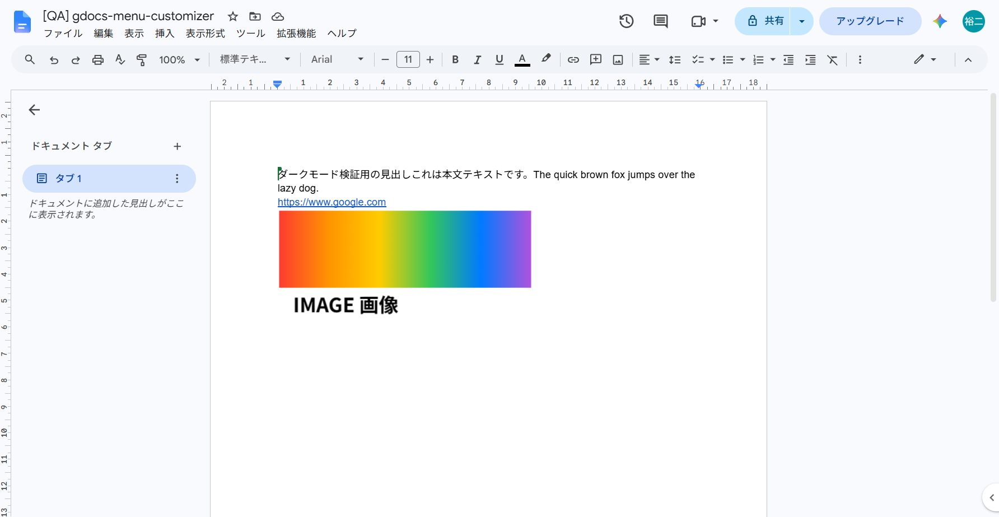
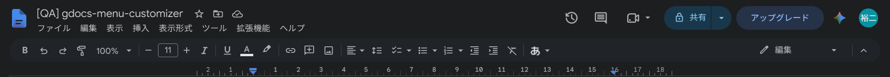
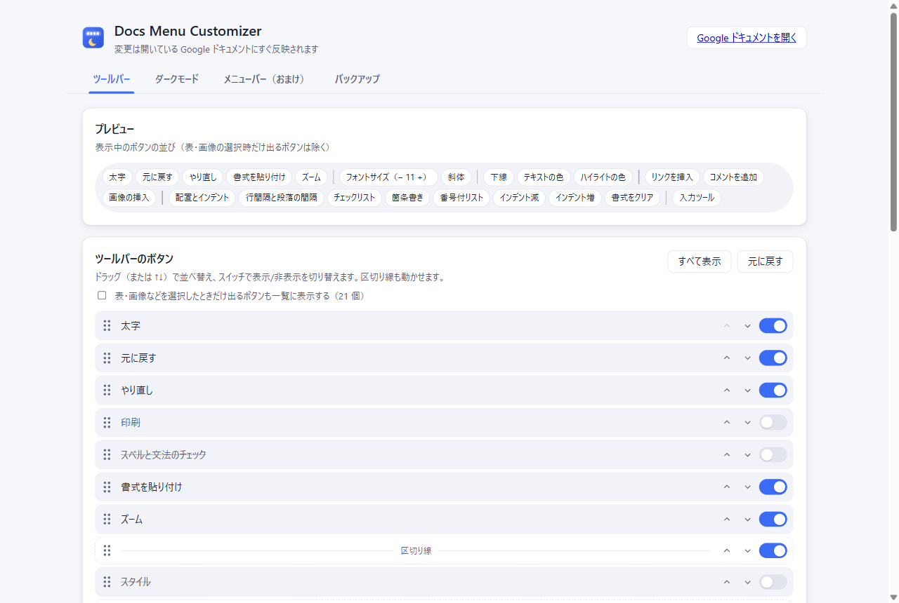
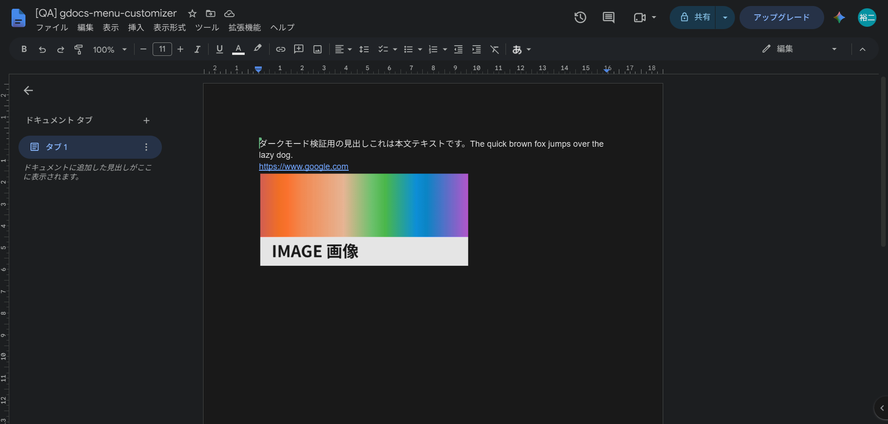
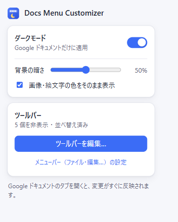
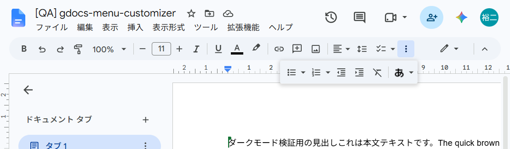
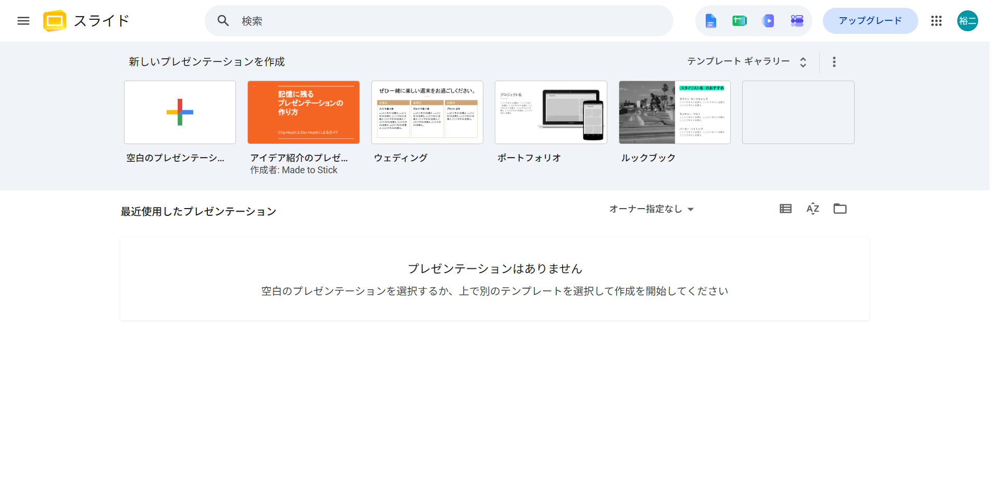

# Docs Menu Customizer

Google ドキュメントの **ツールバー（メニューのバー）を並べ替え・非表示** にでき、**Google ドキュメントだけをダークモード** で表示できるブラウザ拡張機能です。
PC 版 **Brave** を基準に開発・検証しています（Chromium 系なので Chrome でも動作します）。

- ビルド不要・常駐サーバー不要。`extension/` フォルダをそのまま読み込むだけで動きます。
- 設定はブラウザ内（`chrome.storage.local`）に保存され、外部への通信はありません。
- 自分用のため Chrome ウェブストアには公開していません。

| 標準のツールバー | カスタマイズ後（＋ダークモード） |
| --- | --- |
|  |  |

## できること

### 1. ツールバーの並べ替え・非表示（メイン機能）

検索・元に戻す・やり直し・印刷・スペルチェック・書式の貼り付け・ズーム・スタイル・フォント・フォントサイズ・太字/斜体/下線・文字色・ハイライト・リンク・コメント・画像・配置・行間・リスト・インデント・書式クリア・入力ツール・編集モード（鉛筆）・^ ボタン など、ツールバー上のボタンが対象です。

- **並べ替え**: 設定画面でドラッグ＆ドロップ、または各行の ↑↓ ボタン。区切り線も動かせます。
- **非表示**: 各行のスイッチをオフにします。左右端のボタン（検索・鉛筆・^）も消せます。
- **区切り線の自動整理**: 非表示や並べ替えで先頭・末尾・連続になった区切り線は自動で隠します。
- **まとまりの維持**: 「チェックリスト＋▼」のような分割ボタンや「フォントサイズ − 11 +」は 1 つの項目として扱います。
- **狭いウィンドウでも順番どおり**: 幅が足りないとき Docs は末尾のボタンを「⋮（もっと見る）」に移しますが、設定した並び順で先頭から収まる分をツールバーに残すよう振り分け直します。非表示にした分だけ他のボタンが収まります。
- 表や画像を選択したときだけ出るボタン（枠線の色・切り抜きなど）も、「選択時のみ」のボタンを表示するチェックを入れると設定できます。



### 2. ダークモード（Google ドキュメントのみ）

- `https://docs.google.com/document/*` だけに適用します。**スライド・フォーム・スプレッドシートなど他のサービスには影響しません**（拡張機能自体がドキュメント以外では読み込まれません）。
- 本文・メニュー・ダイアログ・サイドバーまでまとめて暗くなります。「背景の暗さ」はスライダーで調整できます。
- 本文中の画像・カラー絵文字、プロフィール写真、色見本は元の色に近い状態で表示します（オフにも可能）。
- ページを開いた瞬間に白く光らないよう、前回の状態を先に当てています。



### 3. おまけ：上段メニューバー（ファイル・編集…）

設定画面の「メニューバー（おまけ）」タブで、ファイル・編集…の並び替え/非表示と、各メニューの中の項目の並び替え/非表示ができます（サブメニューは Docs 上で一度開くと編集できるようになります）。

## Brave への導入手順

1. このリポジトリを任意の場所に置きます（例: `git clone` 済みのフォルダ）。
2. Brave のアドレスバーに `brave://extensions` と入力して開きます。
3. 右上の **「開発者モード」** をオンにします。
4. **「パッケージ化されていない拡張機能を読み込む」** をクリックし、このリポジトリの **`extension` フォルダ** を選択します。
5. ツールバーのパズルアイコンから「Docs Menu Customizer」をピン留めしておくと便利です。
6. Google ドキュメントのファイルを一度開くと、ツールバーのボタン一覧が設定画面に読み込まれます。

> **OneDrive 上に置いている場合**: フォルダが「オンライン専用」になっていると読み込めないことがあります。`extension` フォルダを右クリック →「このデバイス上に常に保持する」にしておくと安心です。

### 更新するとき

`git pull` などでファイルを更新したら、`brave://extensions` で本拡張機能の **再読み込み（↻）** を押し、開いている Google ドキュメントのタブも再読み込みしてください。

## 使い方

- **ポップアップ**（拡張機能アイコンをクリック）: ダークモードのオン/オフ、暗さ、画像の色を保持するかを切り替えます。「ツールバーを編集…」で設定画面を開きます。
- **設定画面**: 「ツールバー」「ダークモード」「メニューバー（おまけ）」「バックアップ」のタブがあります。変更は開いている Google ドキュメントに **すぐ反映** されます（再読み込み不要）。
- **バックアップ**: 設定を JSON で書き出し・読み込みできます。「すべての設定を初期化」で元に戻せます。

| ポップアップ | 狭い幅での「⋮」バブル | 他サービス（スライド）は対象外 |
| --- | --- | --- |
|  |  |  |

## 仕組み（メモ）

- **ツールバー**: Docs はボタンを DOM ごと「⋮」バブルへ出し入れし、そのたびに内部の順序で DOM を組み直します。そのため DOM の並びは書き換えず、ボタンの `id`（`boldButton` など）を指定した CSS の `order` / `display` で見た目を変えています。並べ替えを設定している場合だけ、Docs が組み直した直後に「どのボタンをバブルへ送るか」を設定の順序で振り分け直します。
- **ダークモード**: Docs の本文は `<canvas>` に描画されるため、ページ全体に `invert + hue-rotate` のフィルターをかけ、本文キャンバスの画像・絵文字だけは描画時（`drawImage` / `fillText`）に逆補正をかけて元の色に戻しています。
- **設定の反映**: `chrome.storage.onChanged` で変更を受け取り、その場で再適用します。設定変更直後は Docs にはみ出し判定をやり直させるため、一瞬だけスクロールバーの幅を変えて再計算を促しています。

## 既知の制約

- Google ドキュメントの画面構成（ボタンの id など）が変わると、一部が効かなくなる可能性があります。その場合は設定画面の「元に戻す」で標準に戻せます。
- ツールバー内を矢印キーで移動する順序は、Docs 本来の順序のままです（マウス操作は並べ替え後の順序どおり）。
- ダークモードは色の反転で実現しているため、写真などの鮮やかな色（特に黄色）は少しくすんで見えることがあります。文字色も厳密には元の色そのものではありません。印刷や PDF 書き出しには影響しません。
- 開いているドキュメントで設定を変えた直後、一瞬スクロールバーが表示されることがあります（はみ出し判定のやり直しのため）。
- 上段メニューの項目はラベル（日本語表示名）で識別しているため、Google ドキュメントの表示言語を変えると、その設定は効かなくなります。
- 設定はこのブラウザのプロファイル内だけに保存されます（Brave 同期では共有されません。必要ならバックアップの書き出し/読み込みを使ってください）。

## 開発・QA

拡張機能本体（`extension/`）は素の JavaScript で、ビルド手順はありません。QA 用のスクリプトだけ Node.js / Bun と `playwright-core` を使います。

```powershell
bun install                      # QA 用の依存（playwright-core）だけ入ります
bun qa/launch-brave.mjs <URL>    # 検証用プロファイル（%LOCALAPPDATA%\gdocs-menu-customizer-qa）で Brave を起動
node qa/test-toolbar.mjs         # 設定画面を操作してツールバーへの反映を確認
node qa/test-overflow.mjs        # 狭い幅での「⋮」への振り分けを確認
node qa/test-persist.mjs         # 再読み込み後の反映・狭い幅での再計算を確認
node qa/test-dark.mjs            # ダークモードと、他サービスに影響しないことを確認
node qa/test-menus.mjs           # おまけ（上段メニュー）を確認
node qa/test-ui.mjs              # ポップアップ・設定画面のスクリーンショット（ライト/ダーク）
```

QA スクリプトは、検証用 Brave を `--remote-debugging-port=9333` で起動し、Playwright の CDP 接続で操作します（検証用プロファイルはリポジトリ外に作られます）。

### ファイル構成

```
extension/
  manifest.json
  icons/                     アイコン（tools/make-icons.mjs で生成）
  src/shared/settings.js     設定の既定値・正規化・保存（各画面と content script で共有）
  src/shared/ui.css          ポップアップ・設定画面の共通スタイル（ライト/ダーク対応）
  src/content/core.js        content script の共有状態・カタログ保存・再計算のきっかけ作り
  src/content/toolbar.js     ツールバーの並べ替え・非表示・区切り線整理・「⋮」への振り分け
  src/content/dark.js        ダークモードの切り替え
  src/content/main-world.js  本文キャンバスの画像・絵文字の逆補正（ページ側で実行）
  src/content/menus.js       おまけ：上段メニューバーとドロップダウン項目
  src/content/boot.js        設定の読み込みと各機能への適用
  src/popup/                 ポップアップ
  src/options/               設定画面（sortable-list.js は並べ替えリストの部品）
qa/                          Brave での自動 QA スクリプト
tools/make-icons.mjs         アイコン生成
docs/screenshots/            README 用スクリーンショット
```
